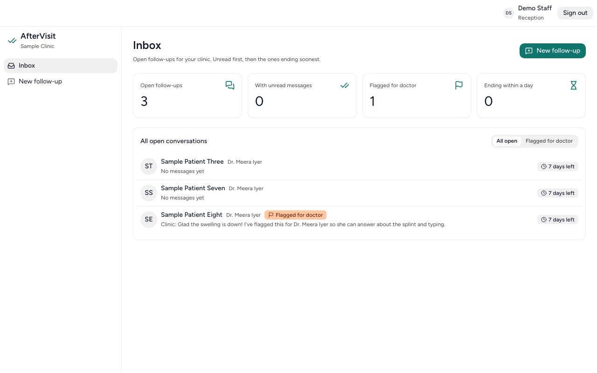
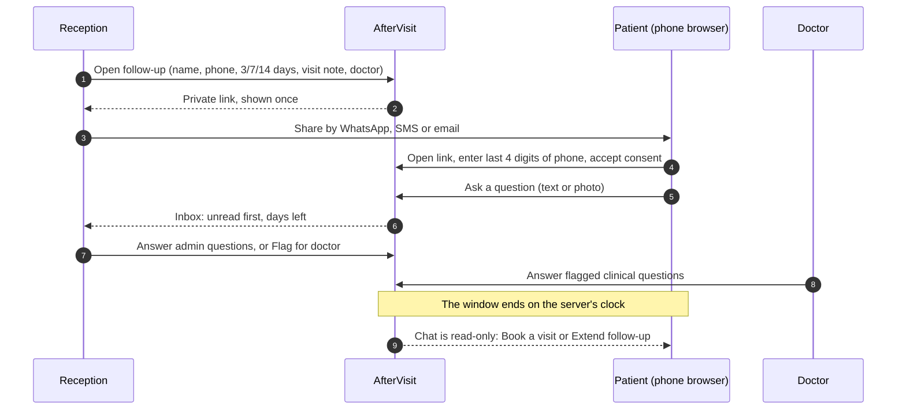
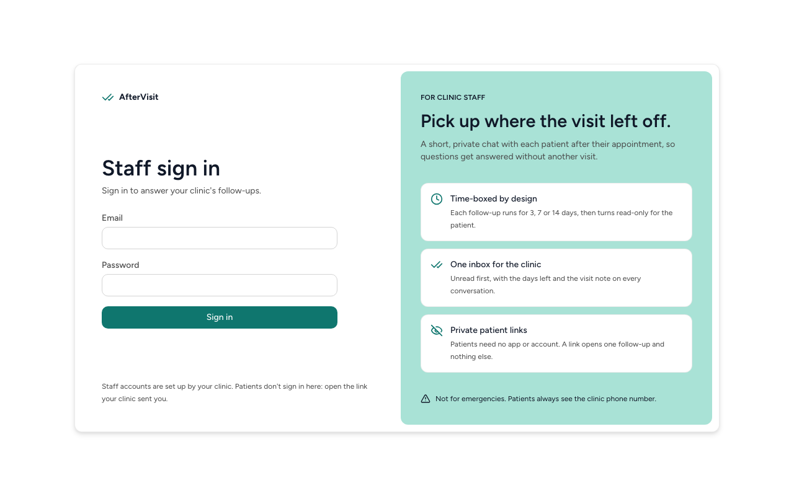
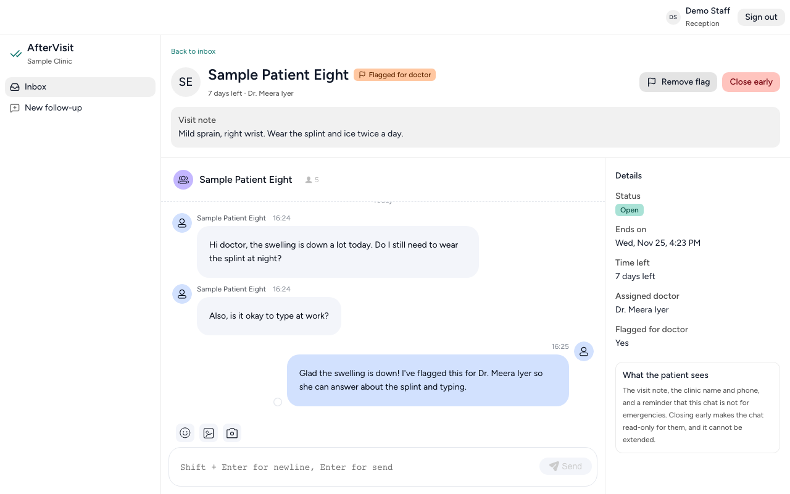
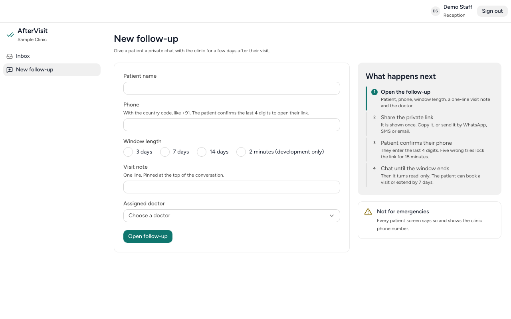
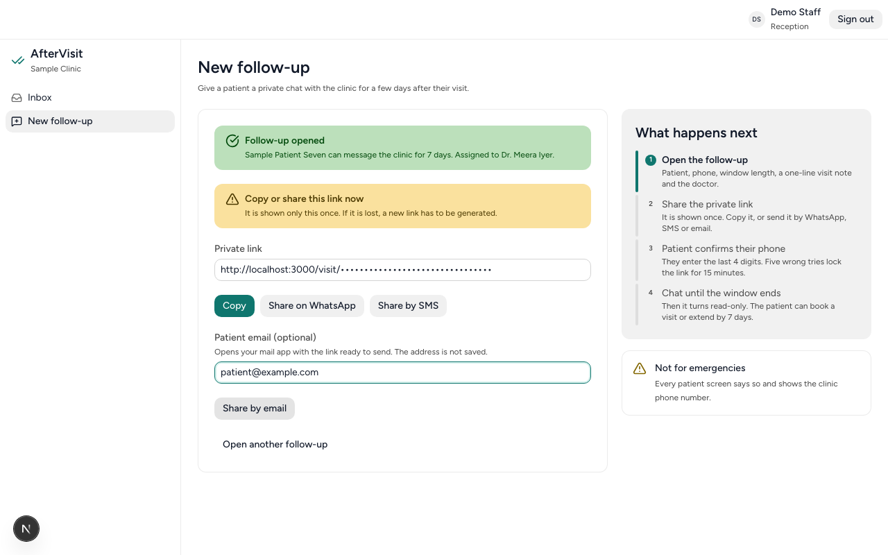
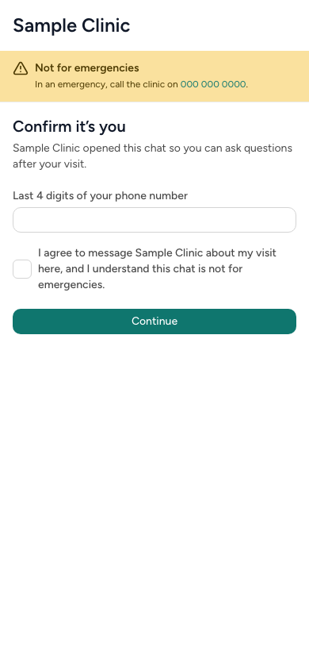
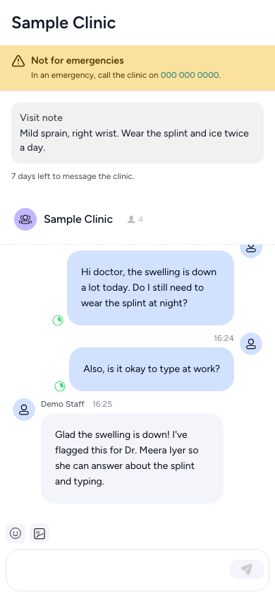
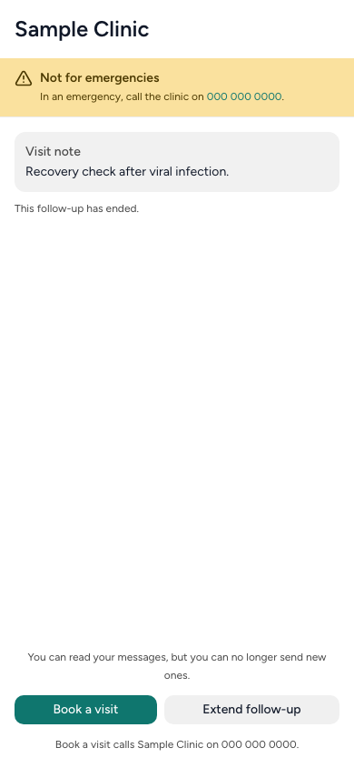
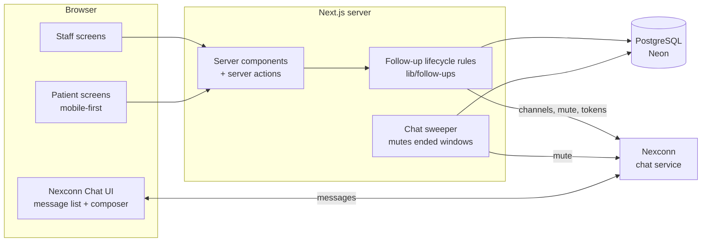

# AfterVisit

**A private, time-boxed chat between a clinic and a patient for the few days after a visit.**

Once the visit is over, the clinic opens a follow-up and sends the patient a private link. The patient opens it on their phone, confirms who they are, and can ask questions for 3, 7 or 14 days. When the time is up, the chat turns read-only. The patient doesn't install an app or create an account, and the doctor doesn't have to give out a personal phone number.



---

## Try it

### Demo login (clinic staff)

| | |
|---|---|
| **Sign-in page** | `/sign-in` |
| **Email** | `demo@aftervisit.example` |
| **Password** | `AfterVisit-Demo-2026` |

**Live app:** [after-visit-flax.vercel.app](https://after-visit-flax.vercel.app/) (sign in at [/sign-in](https://after-visit-flax.vercel.app/sign-in))

This account is shared on purpose and can see only made-up sample data. Running `npm run db:seed` creates it in any development database (see [Run it locally](#run-it-locally)).

### Demo patient links

Patients don't sign in. They open a private link and type the last 4 digits of their phone number. A freshly seeded database contains these sample links:

| Link | Last 4 digits | What you will see |
|---|---|---|
| `/visit/seed-token-1` | `1234` | An open follow-up, flagged for the doctor |
| `/visit/seed-token-3` | `3456` | An open 14-day follow-up, with 12 days left |
| `/visit/seed-token-2` | `2345` | A follow-up the clinic closed early |
| `/visit/seed-token-6` | `6789` | A follow-up whose time ran out, with **Book a visit** and **Extend follow-up** |

> Sample follow-up times are set relative to when the seed runs, so a freshly seeded database shows the states above. Open a patient link in a private window, or a second browser, to play the patient and the clinic side by side.

### A two-minute tour

1. Sign in with the demo login. The inbox lists every open follow-up, with unread conversations first.
2. Go to **New follow-up**, enter a made-up patient, and choose **2 minutes (development only)** as the window length. This short window exists only when running locally (`npm run dev`), so you can watch a window end; production offers 3, 7 or 14 days.
3. Copy the private link it shows. You can also share it by WhatsApp, SMS or email.
4. Open the link in a private window and enter the last 4 digits of the phone number you typed. You are now the patient.
5. Send a message as the patient. It appears in the staff inbox with an unread count.
6. Reply as staff and press **Flag for doctor**.
7. Wait for the 2 minutes to pass. Both screens switch to closed on their own, and the patient can now only read the chat.

---

## The problem

When the visit is over, the questions start. *Is this swelling normal? Can I take this with my other tablets? When can I shower?*

Today those questions reach the clinic in one of three ways:

- **Phone calls** that tie up reception and often end with "the doctor will call you back".
- **WhatsApp to the doctor's personal number**, which never ends: no boundaries, no handover between staff, and the clinic has no record of it.
- **Nothing at all**, because the patient doesn't want to bother anyone. Then a small problem becomes a second visit, or an emergency room trip.

## The solution

AfterVisit gives each visit a short, private follow-up window that the **clinic** owns, not any one person:

- **Time-boxed by design.** Each follow-up runs for 3, 7 or 14 days. The server enforces the end time, not the browser. Afterwards the patient can still read the chat, but can't send anything new.
- **No app, no account.** The patient gets a link by WhatsApp, SMS or email and confirms the last 4 digits of their phone number.
- **One shared inbox.** Reception and doctors work from the same list: unread first, days left on every row, the visit note pinned in each conversation.
- **Clear handover.** Reception answers admin questions and flags clinical ones for the doctor.
- **Safe by default.** Every patient screen says it is **not for emergencies** and shows the clinic's phone number. There are no AI-written replies and no automated medical advice anywhere.

---

## How it works



### For the clinic

| | |
|---|---|
|  |  |
| **Staff sign-in.** Email and password only. Accounts are created by the clinic, and there is no public sign-up. | **A conversation.** The visit note is pinned at the top. Flag for doctor and close early are in the header. The side panel shows the status, end time and assigned doctor. |
|  |  |
| **Opening a follow-up.** Five fields, with a guide to what the patient will be asked to do. | **Sharing the link.** It is shown exactly once, because only its hash is stored. Copy it or share it by WhatsApp, SMS or email. |

### For the patient

| Confirm it's you | Chat with the clinic | After the window ends |
|---|---|---|
|  |  |  |
| Shows only the clinic name and phone until the last 4 digits match. | Text and photos. The visit note and the "Not for emergencies" banner stay on screen. | Read-only. **Book a visit** calls the clinic. **Extend follow-up** adds 7 days through a mock payment. |

---

## Privacy and safety

Medical conversations call for care, so these are rules in the code, not just in the interface:

- **The server owns the clock.** A follow-up is open only while `starts_at <= now() < ends_at` and it hasn't been closed early. That check runs on the **database clock**, in the same SQL statement as the write. A patient with a wrong device clock, or a crafted request, can't send after the window ends.
- **Patients are muted at the chat provider too.** When a window ends, a background sweeper mutes the patient in the chat service, so the app's own screens aren't the only barrier.
- **Link tokens are never stored.** Patient links and patient sessions are 32 random bytes. Only their SHA-256 hash is saved, so a database leak exposes no working links. When a new link is generated, the old link stops working and its chat access is revoked at once.
- **Identity check with lockout.** The patient must enter the last 4 digits of their phone. Five wrong tries lock the link for 15 minutes. Before that check passes, the page shows nothing about the patient.
- **No patient details in the browser tab.** Every patient page is titled just "AfterVisit". The browser receives only the visit note, the window state and display names.
- **Clinic isolation.** Every staff query is filtered by the signed-in member's clinic. Another clinic's follow-up is reported as "not found", not "forbidden".
- **Staff sign-in is rate-limited** to 5 attempts a minute, and is checked against the database on every request.
- **Messages never touch our database.** They live only in the chat provider. AfterVisit stores no message copies, analytics or audit trail of conversations.
- **No AI in the conversation.** Every reply is written by a person at the clinic.

---

## How it's built



| Layer | Choice | Why |
|---|---|---|
| Framework | **Next.js 16** (App Router), **React 19**, TypeScript | Server components keep data access and permission checks on the server |
| UI | **Astryx** design system, with StyleX for overrides | One consistent, accessible component set. Staff screens are built for 1280px, patient screens for a 380px phone |
| Database | **PostgreSQL** on Neon, through **Drizzle ORM** | Typed SQL with generated, committed migrations. The open/closed state is derived, never stored |
| Staff auth | **Better Auth** (email and password) | Database sessions and built-in rate limiting. Sign-up, password reset and social login are all switched off |
| Chat | **Nexconn** Chat SDK and prebuilt Chat UI | Real-time messaging, photos and unread counts, without storing messages ourselves |
| Tests | Node's built-in test runner against a real database | Each test rolls back what it writes |

### Where things live

```
app/
  sign-in/                 Staff sign-in
  (staff)/inbox/           Inbox and conversation screens
  (staff)/follow-ups/new/  Open a follow-up and share the link
  (patient)/visit/[token]/ Patient confirmation, chat and ended state
lib/
  follow-ups/lifecycle.ts  The rules: open, flag, close early, extend, regenerate link (with tests)
  chat/                    Nexconn server client, channel gate, sweeper, browser hooks
  db/                      Schema, migrations, seed, staff:create script
  current-staff.ts         The one place staff access is checked
docs/PRODUCT.md            The product spec. The source of truth for every feature
```

---

## Run it locally

**You need:** Node.js 20.9 or newer, a PostgreSQL database (a free [Neon](https://neon.tech) project works), and a [Nexconn](https://console.nexconn.ai) app for chat.

```bash
git clone https://github.com/giriyaram/after-visit.git
cd after-visit
npm install

cp .env.example .env.local   # then fill in the values (each one is explained in the file)

npm run db:migrate           # create the tables
npm run db:seed              # sample clinic, staff, patients and the demo login
npm run dev                  # http://localhost:3000
```

Then sign in with the [demo login](#demo-login-clinic-staff), or with a seeded staff member (`asha.nair@sample-clinic.example` or `meera.iyer@sample-clinic.example`), using the `SEED_STAFF_PASSWORD` you chose.

In the Nexconn console, turn on **"Enable pre-join history access by new member"** for Group channels, so staff who join later can see earlier messages.

### Scripts

| Command | What it does |
|---|---|
| `npm run dev` | Development server |
| `npm run build` / `npm start` | Production build and server |
| `npm test` | Lifecycle, input and chat tests against the database in `.env.local` (each test rolls back) |
| `npm run lint` | ESLint |
| `npm run db:migrate` | Apply migrations |
| `npm run db:seed` | Reset to the sample data. Refuses to run in production |
| `npm run staff:create` | Add a real staff member (asks for the password at a hidden prompt) |

> The chat sweeper that mutes patients when a window ends needs a long-running server (`next dev` or `next start`). On a serverless host, a scheduled job would call `muteEndedWindows` instead.

---

## Honest limits and what's next

- **Payments are mocked.** Extend follow-up goes through a test payment that charges nothing. A real provider replaces one function (`lib/mock-payment.ts`).
- **Two chat-provider gaps.** Through Nexconn's API, a patient could still create a side group with staff, or recall their own message after the window closes. Closing these needs Nexconn's pre-messaging webhook. No AfterVisit screen shows such side groups.
- **No button yet for a new patient link.** The server action exists and is tested; it is not wired to a screen yet.
- **Out of scope for now:** native apps, real payments, appointment booking, prescriptions, managing several clinics, and analytics.

---

*AfterVisit is a demo. All names, phone numbers and visit notes in it are made up. It is not a medical device, and the chat is not for emergencies.*
